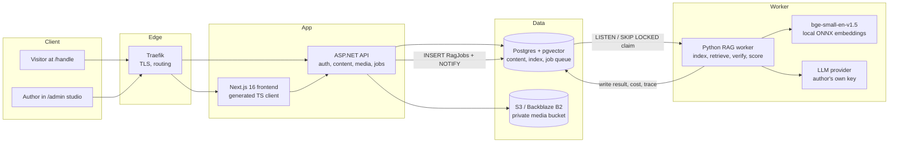
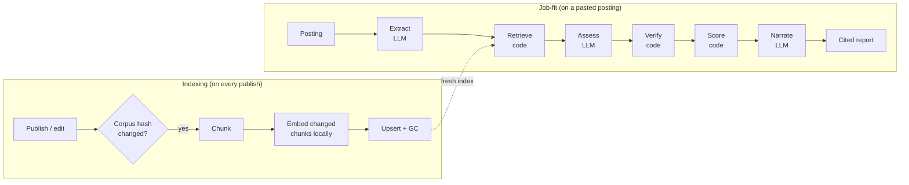
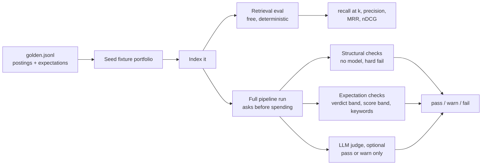

<p align="center">
  
</p>

<h1 align="center">PortfolioRAG</h1>

<p align="center">
  <strong>A portfolio that can prove it.</strong><br />
  Multi-author portfolios with a job-fit engine that cites every claim or doesn't make it.
</p>

<p align="center">
  
  
  
  
  
</p>

---

Every author gets a public portfolio at `/<handle>` and a studio to run it. A recruiter can paste a job
posting into that portfolio and get back which requirements the author's **published** work actually
evidences, with the passage behind every claim.

Most "AI resume matchers" produce confident prose about experience nobody has. This one is built the
other way round: **the model proposes, the code disposes.** Every judgement an LLM makes is checked or
replaced by something deterministic before a reader sees it:

- A citation to a passage the model was never shown is **dropped**.
- A quote that isn't really in the passage it cites is **dropped**.
- A claim left with no surviving evidence is **demoted to "not shown"**. It isn't quietly kept.
- The score is **arithmetic, not a model's opinion**, so two runs on the same evidence give the same number.

---

## Connect your assistant (MCP)

Let Claude (or any MCP client) draft and publish posts on your BlogRAG portfolio:

```sh
claude mcp add --transport http blograg https://mcp.blograg.pbh-dev.tech/mcp
```

The first tool call opens a browser to sign in and approve the connection, in **drafts only** or
**full editing** mode. Disconnect any time from the studio's **Access & tokens** tab.
Details: [`mcp-server/README.md`](mcp-server/README.md).

## Running it yourself

**Prerequisites:** Docker, .NET 10 SDK, Node 22, [uv](https://docs.astral.sh/uv/).

```sh
# Infrastructure: Postgres + pgvector on :5433, MinIO on :9000 (console :9001)
docker compose up -d

# API on http://localhost:5009 (Swagger UI at /swagger)
dotnet ef database update --project backend/backend.csproj
dotnet run --project backend

# Frontend on http://localhost:3000
cd frontend && cp .env.example .env.local && npm ci && npm run dev

# RAG worker (its encryption key must match the API's Llm:EncryptionKey)
cd rag && cp .env.example .env && uv sync && uv run rag-worker

# MCP server on http://localhost:8000/mcp
cd mcp-server && uv sync && \
  BLOGRAG_MCP_API_URL=http://localhost:5009 \
  BLOGRAG_MCP_PUBLIC_API_URL=http://localhost:5009 \
  BLOGRAG_MCP_PUBLIC_URL=http://localhost:8000/mcp \
  uv run blograg-mcp
claude mcp add --transport http blograg-local http://localhost:8000/mcp
```

After changing a controller or DTO, regenerate the typed client: `cd frontend && npm run generate-api`.
No API key? `rag-local` runs the model stages in a chat site you're signed in to; see
[`rag/README.md`](rag/README.md#running-it-locally).

---

## Architecture



| Piece | What it does | Why it's built this way |
|---|---|---|
| **Frontend** (`frontend/`) | Public portfolios and the author studio. | API clients are **generated from the OpenAPI spec**, so the frontend can't drift from the backend's contract. |
| **API** (`backend/`) | Auth (email + Google, JWT and scoped API tokens), content, media, analytics, job orchestration. | It never runs a model. It writes a job row and returns immediately, and the browser polls for the result. |
| **RAG worker** (`rag/`) | Drains the job queue: indexing, retrieval, job-fit, cover letters. | It exposes **no port**. Nothing talks to it; it only reads and writes the database. Scale it with `--scale rag=N`. |
| **Postgres + pgvector** | Content, vector index (HNSW), keyword index (GIN `tsvector`), **and the job queue**. | One database instead of a database plus a broker. The job, its result, its cost and its audit trail live in the same row, next to the data they were computed from. |
| **Object storage** | Post media and avatars in a **private** bucket, served via expiring links. | MinIO locally (private and versioned, like B2) so the delete-every-version path is exercised before production. |

---

## The flow



Three stages use a model and three are plain code. Every citation is checked against the passages
actually shown, and the score is a formula. Full walkthrough: [`docs/pipeline.md`](docs/pipeline.md).

---

## Evaluation

The eval harness lives in `rag/eval/` and runs against a **fixture portfolio** (`eval/datasets/portfolio.json`)
seeded into a scratch account and deleted afterwards. Results don't depend on anyone's dev database.
With `--container`, it runs in a throwaway `pgvector` container migrated with the API's own migrations.



Metrics, checks, the golden set and reproducibility: [`docs/evaluation.md`](docs/evaluation.md).

---

## Docs

| Doc | What's in it |
|---|---|
| [`docs/pipeline.md`](docs/pipeline.md) | Adding content, chunking and embedding, the six job-fit stages, citation verification and scoring |
| [`docs/evaluation.md`](docs/evaluation.md) | Retrieval metrics, structural and expectation checks, the LLM judge, the golden set, reproducibility |
| [`docs/testing.md`](docs/testing.md) | Test and eval commands, adversarial unit tests |
| [`docs/guardrails.md`](docs/guardrails.md) | Key handling, budgets and limits, token scopes, provider adapters |
| [`rag/README.md`](rag/README.md) | The retrieval worker and `rag-local` |
| [`rag/src/rag/providers/README.md`](rag/src/rag/providers/README.md) | Adding an LLM vendor |
| [`mcp-server/README.md`](mcp-server/README.md) | The MCP connector, its OAuth flow and tools |
| [`deploy/README.md`](deploy/README.md) | CI/CD, automatic rollback, provisioning, production runbook |

---

## Repository layout

```
backend/         ASP.NET API: controllers, services, EF Core migrations
backend.Tests/   xUnit, against a real Postgres fixture
frontend/        Next.js 16 app: public portfolios + /admin studio
  lib/api/generated/   OpenAPI-generated TypeScript client (do not hand-edit)
rag/             Python worker
  src/rag/       corpus, chunking, embeddings, indexing, retrieval, citations, scoring, pipeline
  eval/          fixture portfolio, golden set, metrics, judge, reports
  tests/         unit + integration
mcp-server/      Remote MCP server: lets an AI assistant write posts (OAuth, drafts only or full editing)
deploy/          Ansible, deploy/backup scripts, production runbook
docs/            Detailed design, eval and testing notes
```
