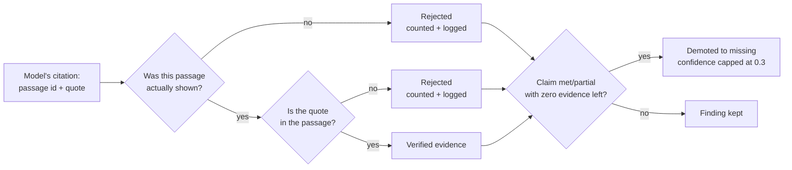

# The pipeline, in detail

How content becomes passages, and how a job posting becomes a cited report.

## 1. Adding content

Authors write in the studio: Markdown posts, an experience timeline, a profile. Every save that could
change what the portfolio says calls `RagIndexScheduler`, which marks that source **Queued** in the
studio's index table and enqueues an `Index` job. The author can see, per post, whether it's queued,
indexing, indexed, or failed and why.

Only **published** material enters the corpus (`rag/src/rag/corpus.py`). A draft can never be cited to a
recruiter. Uploaded media is checked by **file signature**, not by extension or the client's
`Content-Type`, so a renamed executable doesn't become an "image".

## 2. Indexing and embedding

**Chunking** (`rag/src/rag/chunking.py`) is deterministic. The document is split on Markdown headings first,
so passages follow the author's structure, then into ~900-character windows with 150 characters of
overlap. Fragments under 120 characters are merged into the previous passage instead of becoming
passages that mean nothing on their own. Each passage is prefixed with its breadcrumb
(`[Vector Core > Replication]`), so a passage retrieved alone still says where it came from.

**Embedding** runs locally: `BAAI/bge-small-en-v1.5` via fastembed's ONNX runtime. That means 384
dimensions, no API key, no per-call cost, and no torch in the image. Because embedding is free, the index
can be rebuilt as often as it needs to be.

**Freshness is checked, not remembered.** Every analysis calls `indexing.ensure` first:

- A SHA-256 **corpus hash** over every source. If it's unchanged, the run costs two queries and no model time.
- A SHA-256 **content hash** per passage. Only passages whose text changed, or whose vector is missing, are re-embedded.
- Passages whose source was deleted are removed.

Nothing in the API has to remember to invalidate a cache, so the index can't go stale.

Failures stay with the source that caused them. One post that fails to embed is marked failed with its
reason, the rest still land, and the failed post **keeps yesterday's passages**, so today's bad edit
doesn't make it disappear from retrieval. The corpus hash is only written when every source succeeded,
so the next run retries the failures instead of skipping them.

The embedding width is checked at startup. If `RAG_EMBEDDING_DIMENSIONS` disagrees with the
`vector(384)` column, the worker refuses to start instead of writing vectors the column would reject.

## 3. Job-fit analysis

Six stages. Three use a model and three are plain code, and that split is the core of the design.

| # | Stage | Runs on | What it does |
|---|---|---|---|
| 1 | **Extract** | LLM | Turns the posting into discrete requirements, each marked essential or nice-to-have, **each with its own search query**. |
| 2 | **Retrieve** | Code | Dense (cosine over HNSW) **and** sparse (`ts_rank_cd` over GIN) for every query, fused with **Reciprocal Rank Fusion** (k=60), then diversified with **MMR** (λ=0.65). |
| 3 | **Assess** | LLM | For each requirement: met / partial / missing, a confidence, and citations to passage ids with quotes. |
| 4 | **Verify** | Code | Checks every citation against the passages that were actually shown. See below. |
| 5 | **Score** | Code | Weighted share of evidenced requirements, 0 to 100. |
| 6 | **Narrate** | LLM | Writes the summary from **verified findings only**. It never sees the passages. |

What each design choice fixes:

- **Extract before retrieve.** Embedding a 2,000-word posting as one vector gives you a vector for the
  *average* of the posting, which retrieves the portfolio's most generically impressive passages.
  Searching per requirement is what lets the tenth requirement be found at all.
- **Dense *and* sparse.** Vector search matches "built a scheduler for batch workloads" to "distributed
  job orchestration" but misses "Kubernetes" mentioned once in passing. Keyword search does the
  opposite. Postings are full of both kinds of requirement.
- **RRF instead of score blending.** Cosine similarity and `ts_rank_cd` live on different scales. RRF
  ignores the scores and keeps only the ranks, so there's no conversion to re-tune when either side changes.
- **MMR.** Without it, the top of the fused list is the same project four times.
- **Narrate last, blind.** Because stage 6 only receives verified findings, the prose can't bring back a
  claim that failed verification.

The pipeline doesn't know where passages come from. It takes a `Retriever` with two methods. In
production that's the database; in `rag-local` it's an HTTP client holding an API token. Both run the
same stages and the same verifier.

## 4. Checking: why the output can be trusted

This is the stage that matters most. The worst failure isn't a wrong answer. It's a fluent claim about
experience the author doesn't have, published on the author's own site. `rag/src/rag/citations.py`
enforces three rules:



1. **The passage must exist and must have been shown.** A `document_id` outside the retrieved set is a
   fabricated citation and is dropped.
2. **The quote must actually appear in it.** Both sides are Unicode-normalized (NFKC), case-folded and
   whitespace-collapsed, then compared as an exact substring. If that fails, a quote of at least 4 words
   still passes only if **≥ 80% of its words** appear in the passage. That tolerates light paraphrase and
   rejects invention.
3. **No evidence, no claim.** A `met` or `partial` finding with no surviving citation is rewritten as
   `missing`, its confidence is capped at 0.3, and the rationale says the claim was withdrawn.

Every rejection is counted and returned with the report (`citations_rejected`, `passages_cited`,
`passages_considered`) along with a full retrieval trace, so a bad answer can be diagnosed later.

**Scoring is a formula** (`rag/src/rag/scoring.py`):

```
score   = round( Σ weight·value / Σ weight × 100 )
value   = met 1.0 · partial 0.5 · missing 0.0
weight  = essential 1.0 · nice-to-have 0.35

verdict = strong ≥ 85 · promising ≥ 65 · partial ≥ 40 · weak
          ...and never "strong" while any essential requirement is unmet
```

An LLM asked to rate a candidate out of 100 gives a number that drifts between runs, clusters in the
seventies, and doesn't move when a requirement is demoted. A formula always moves in the same direction.
That's the only way two runs can be compared, and the only way the eval can tell an improvement from noise.
