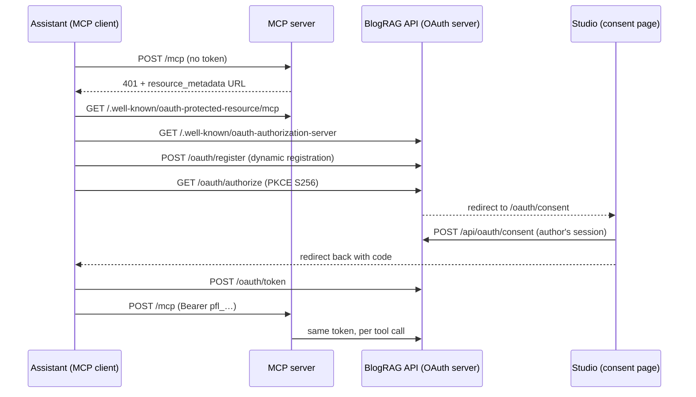

# BlogRAG MCP server

A remote [MCP](https://modelcontextprotocol.io) server that lets an AI assistant write posts on a
BlogRAG portfolio. Each connection has one of two modes, which you choose when you approve it and
can switch at any time from the studio's **Access & tokens** tab:

- **Drafts only** (the default). The assistant can read your posts, create and edit drafts, upload
  pictures, a thumbnail and a trailer, and publish when you tell it to. It can never delete
  anything, edit or unpublish a live post, or replace existing artwork.
- **Full editing.** All of that, plus editing live posts, replacing artwork, unpublishing, and
  deleting posts and files. Deleting still needs your explicit go-ahead on every call.

Neither mode can touch your profile, timeline, credentials or account.

```
claude mcp add --transport http blograg https://mcp.blograg.pbh-dev.tech/mcp
```

The first tool call opens a browser to sign in to BlogRAG and approve the connection. You can
disconnect it at any time from the studio's **Access & tokens** tab.

## How it fits together



- **Tokens.** The access token is an ordinary `pfl_` API token with an hour to live. The refresh
  token rotates, and replaying a spent one revokes the whole grant.
- **Modes.** The grant stores the mode (`posts`, or `posts posts:edit` for full editing), and the
  API reads it off the grant on every request. A token acts as `Author` (drafts only) or `Editor`
  (full editing). Switching the mode in the studio applies to the app's very next request, with
  no reconnecting.
- **Enforcement lives in the API, not here.** A drafts-only token is refused any `DELETE`, any write
  to an endpoint not marked `[AllowAuthorScope]`, edits to a published post, and anything that would
  replace a thumbnail or trailer. A full-editing token may also use endpoints marked
  `[AllowEditorScope]`, but still only post and media routes. The tool list is the same in both
  modes, because a stateless server can't vary it per connection. The API is what refuses.
- **Uploads.** The server isn't on your machine, so it can't read your files. `request_upload`
  returns a one-time URL, and the assistant sends the file there itself with `curl -F`. The ticket
  fixes the post, the role and the caption in advance, and it expires after 15 minutes.
- **Token verification.** Each token is checked by asking the API (`GET /api/auth/me`), and the
  answer is cached for 30 seconds. Disconnecting an app in the studio cuts it off within that window.

## Tools

| Tool | What it does |
| --- | --- |
| `whoami` | The account this connection writes to |
| `list_posts` | Your posts, filterable by drafts / published / search |
| `get_post` | One post in full, with its media |
| `list_media` | A post's files, each with the Markdown that embeds it |
| `check_publish_readiness` | What's missing before a draft can go live |
| `create_draft` | A new post, as a draft |
| `update_draft` | Change a draft; omitted fields are kept |
| `update_post` | Change any post, live ones included. Full editing only |
| `request_upload` | A one-time upload URL for a thumbnail, trailer or attachment |
| `set_media_caption` | Rewrite a file's alt text |
| `publish_post` | Publish a draft. Requires `user_confirmed=true` |
| `unpublish_post` | Take a live post back to draft. Full editing only |
| `delete_post` | Delete a post and its files. Full editing only, requires `user_confirmed=true` |
| `delete_media` | Delete one file. Full editing only, requires `user_confirmed=true` |

## Running it

```
uv sync
BLOGRAG_MCP_API_URL=http://localhost:5009 \
BLOGRAG_MCP_PUBLIC_API_URL=http://localhost:5009 \
BLOGRAG_MCP_PUBLIC_URL=http://localhost:8000/mcp \
uv run blograg-mcp
```

The API needs `OAuth:Issuer` set to the same value as `BLOGRAG_MCP_PUBLIC_API_URL`, and
`OAuth:ConsentUrl` pointing at the studio's `/oauth/consent`. `appsettings.Development.json` does
both for `localhost:5009` and `localhost:3000`.

| Variable | Meaning |
| --- | --- |
| `BLOGRAG_MCP_API_URL` | How this server reaches the API (`http://api:8080` in compose) |
| `BLOGRAG_MCP_PUBLIC_API_URL` | The API's public origin, which is the OAuth issuer. Must match `OAuth:Issuer` exactly |
| `BLOGRAG_MCP_PUBLIC_URL` | This server's public URL including `/mcp`. Its origin must be in `OAuth:AllowedResources` |
| `BLOGRAG_MCP_ALLOWED_HOSTS` | Host headers accepted (DNS-rebinding protection). Defaults to the host of `PUBLIC_URL` |
| `BLOGRAG_MCP_TOKEN_CACHE_SECONDS` | How long the API's verdict on a token is reused (default 30) |

## Tests

```
uv run pytest -q
uv run ruff check . && uv run ruff format --check .
```

They run against a fake API (`tests/conftest.py`), so they need no network. The real flow, from
discovery through registration, consent, tokens and every tool, was exercised by hand against a local
API with the SDK's own OAuth client.
